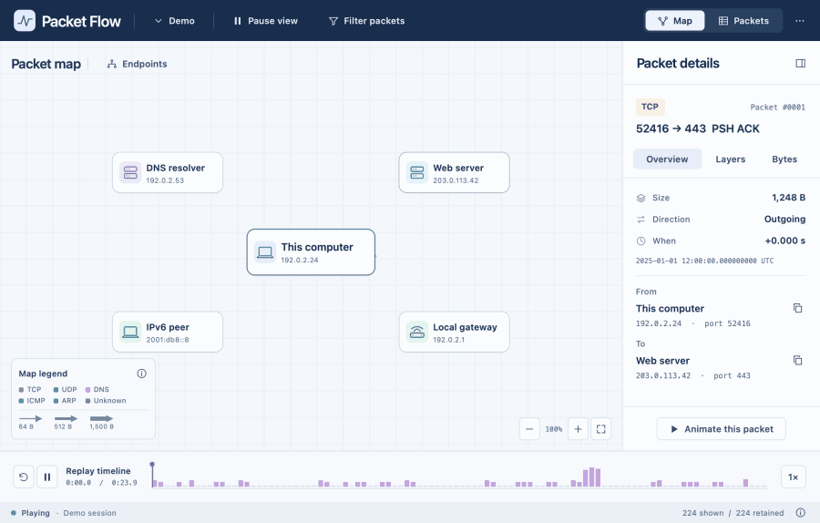

# Packet Flow

A native macOS packet analyzer built with C++20, Qt Quick, and libpcap. It opens in a deterministic demo with 224 synthetic Ethernet frames. Click a growing arrow to inspect the packet that produced it. Pause the view to see the shaft attached to its sender, then use **Layers** to jump from a decoded field to its captured bytes.

[](docs/packet-map.png)

[View the full-size screenshot](docs/packet-map.png)

## Build and launch on macOS

If you already built Packet Flow, launch it from the repository directory with `open build/PacketFlow.app`. After editing the source, run `cmake --build build` and reopen the app.

For a first build, install the Xcode Command Line Tools and Homebrew, then run the following commands from the repository directory. The macOS SDK provides libpcap.

```sh
brew install qtdeclarative cmake ninja libmaxminddb
cmake -S . -B build -G Ninja -DCMAKE_BUILD_TYPE=Release -DBUILD_TESTING=ON
cmake --build build
ctest --test-dir build --output-on-failure
open build/PacketFlow.app
```

This development bundle uses the installed Qt frameworks. For a Qt installation outside Homebrew, supply its prefix through `-DCMAKE_PREFIX_PATH=/path/to/Qt`. A missing pcap header or library on macOS usually indicates a missing or inactive Command Line Tools SDK.

To build and test the decoder, replay primitives, and reader without Qt, use the following commands.

```sh
cmake -S . -B build-core -G Ninja -DPACKETFLOW_GUI=OFF -DCMAKE_BUILD_TYPE=Release
cmake --build build-core
ctest --test-dir build-core --output-on-failure
```

## Enable live capture on macOS

If you see `(cannot open BPF device) /dev/bpf0: Permission denied`, your account needs permission to read packets from a network interface. **Try demo** and **Open capture** work without this permission.

1. Open Terminal and install ChmodBPF. Enter your administrator password if prompted.

   ```sh
   brew install --cask wireshark-chmodbpf
   ```

2. Restart your Mac so the new `access_bpf` group membership takes effect. [Homebrew’s ChmodBPF instructions](https://formulae.brew.sh/cask/wireshark-chmodbpf)
3. Reopen Packet Flow as your usual user. In the toolbar’s source menu, choose **Live interfaces…**, select the interface you want to observe (for example, Wi-Fi), and click **Start capture**.

To capture this Mac’s internet traffic, choose the interface carrying your default route. Run `route -n get default` in Terminal and match its `interface` line to the list in Packet Flow. A VPN can route traffic through a `utun` interface. Choose `lo0` for connections between processes on this Mac.

## Show endpoint countries, cities and flags

Open **Endpoints → Show IP locations**. The map, endpoint list and endpoint inspector show the country flag and available city and country for public IPv4 and IPv6 addresses. The setting starts off and is remembered across launches. All lookups run locally. City estimates can describe a VPN exit or CDN server. Private addresses and the demo’s example addresses have no geographic label.

If Packet Flow asks for a database, download the **MMDB** edition of [DB-IP City Lite](https://db-ip.com/db/download/ip-to-city-lite), decompress the `.gz` file, then open **Endpoints → Database… → Choose database…** and select the `.mmdb` file. Keep it at that path. The same menu lets you switch to a newer database. Compatible City and Country MMDBs also work. Country-only databases provide a country and flag.

To include a local database in a macOS app build, run the following from the repository directory. Fresh checkouts use the file chooser unless you supply this build option.

```sh
cmake -S . -B build -DPACKETFLOW_GEOIP_DATABASE=/absolute/path/to/city.mmdb
cmake --build build
```

DB-IP City Lite provides monthly location estimates under [Creative Commons Attribution 4.0](https://creativecommons.org/licenses/by/4.0/). [IP Geolocation by DB-IP](https://db-ip.com/)

## Use the analyzer

- **Demo** in the toolbar opens the source menu. **Try demo** restarts the local fixtures, **Open capture** loads a local file, and **Live interfaces** lets you choose an interface before pressing **Start capture**. The demo generates no network traffic.
- **Map** places peers at even angles around the local or focused device. Larger groups share concentric rings, and the spacing accounts for the width of the cards and their location labels. The map starts with four peers. Open **Endpoints → Maximum peers on map** to choose 4–100. The local or focused node has its own slot. The app remembers the limit on restart. Each visible peer keeps its ring slot and the camera holds its position as traffic changes. A returning peer reuses its previous slot if still reserved. New peers use empty slots first, then slots belonging to hidden peers when the ring layout is full. Drag a card to place it, drag the background to pan, and scroll to zoom. **Fit view** frames the current cards. **Endpoints → Reset layout** restores automatic placement. Dragged positions are kept for the current session while the endpoint is retained.
- **Endpoints → Hide idle peers after** sets the map’s inactivity timer. Slide from **Off** to **1–120 seconds**. Sending or receiving a packet resets a peer’s timer. When it expires, the card disappears and its slot becomes available. New traffic makes the peer eligible to appear again. The local or focused card stays visible, and packet history and endpoint search remain available. Pausing freezes the timer. **Go live** catches up to current activity, and seeking a replay shows the peers active at that point. Packet Flow remembers the slider setting.
- **Endpoint groups** in **Endpoints** let you show web servers, DNS servers, other endpoints, or a combination. **All** restores the full set. The groups apply to the map and endpoint search. Packet rows and CSV export continue to use the packet display filter. Web server candidates use TCP port 80 or 443 or UDP port 443 on their own side of a packet. DNS server candidates use port 53 in decoded DNS traffic. An address can belong to both groups. Selecting an endpoint opens its inspection and focus controls. Files open with a neutral map. Choosing a focus defines the reference point for direction.
- **Packets** lists the entire retained set matching the display filter. Left and right arrow keys select adjacent records. Space toggles playback. **Animate this packet** previews the selected record at its current endpoints. **Reduce motion**, under the ellipsis menu, replaces arrows with activity counts.
- **Replay timeline** shows activity across the loaded range, including packets outside the display filter. Click or drag to seek. The speed menu ranges from 0.25× to 4×. Original gaps remain intact. Equal or backward timestamps share a nondecreasing playhead in input order. The inspector keeps the original UTC timestamp. Playback includes a short tail for the final arrow to fade.
- **Pause view** during live capture holds the visual clock while the worker continues reading. **Go live** discards the animation backlog. **Stop** releases the capture handle and leaves retained records available. Live capture uses nonblocking reads, a 65,535-byte snapshot, and promiscuous mode off. Endpoint names come from demo fixtures. Live and file sessions use numeric addresses.
- **Filter packets** combines protocol, peer address, direction, inclusive size bounds, and one optional expression. Supported expressions are `protocol = dns`, `port = 53`, `length >= 512`, and `length <= 1500`. Use spaces around the operator. Port matches either endpoint. Invalid input leaves the active filter in place.
- **Export filtered CSV** saves the matching retained rows locally. Columns contain session ID, captured Unix timestamp and replay offset in integer nanoseconds, numeric source and destination, optional ports, decoded type, original and captured byte counts, summary, and parse status. Unknown ports and unavailable original sizes are empty. Fields are quoted, embedded quotes are doubled, and spreadsheet formula prefixes are escaped with an apostrophe.

## Reader and display limits

| Area | Behavior |
| --- | --- |
| Capture files | Classic microsecond and nanosecond PCAP, plus compatible PCAPNG through libpcap. Tests cover a little-endian, single-Ethernet-interface PCAPNG with enhanced packet blocks. Reader errors retain the readable prefix. Mixed link types and unsupported encapsulations can produce a backend error. |
| Decoding | Ethernet, up to four VLAN tags, BSD NULL/LOOP, raw IP, ARP, IPv4, IPv6, TCP, UDP, ICMP and ICMPv6. Up to eight IPv6 hop-by-hop, routing, fragment, destination-option or AH headers. Non-initial fragments remain opaque. |
| Application data | DNS recognition requires a structurally complete standard message on port 53 with a valid question and bounded name parsing. TCP requires a complete length-prefixed message in the packet. Other payloads remain available as bytes. Stream reassembly and TLS decryption are outside this release. |
| Import and retention | Up to 24,000 records or 48 MiB of captured bytes, with a 1 MiB per-frame reader ceiling. Files stop at a labeled prefix. Live sessions evict the oldest records. A source worker owns its pcap handle and transfers batches through a mailbox limited to 1,024 records and 4 MiB. File readers wait for room. Live readers count discarded records. |
| Animation | A 570 ms extension, 65 ms hold and 220 ms fade use the same clock for head and shaft. Each route has an arc-length lookup table. A single custom Qt Quick painted item draws the map. Motion duration illustrates direction. Capture timestamps supply the timing measurements. |
| Overload | Round-robin scheduling across endpoint pairs admits up to 24 scheduled arrows, with three simultaneous packets per pair. An explicit inspector preview has a separate lane. A count on the map summarizes omitted activity. Seeking reconstructs at most 1,024 recent records. |
| Counters | Session statistics distinguish reader deliveries, retained and filtered records, worker queue loss, retention eviction, backend drops and skipped display animations. A file limit check may read one record beyond the retained prefix. The macOS backend counter is libpcap’s latest buffer-drop report. Unavailable statistics display **Unavailable**. Interface hardware drops are outside that counter. [libpcap statistics](https://www.tcpdump.org/manpages/pcap_stats.3pcap.html) |

## Verification

Tested on macOS 27.2.1, Apple M5, 16 GB RAM, with Apple Clang 21, Qt 6.12.0 and Apple libpcap 1.10.1. Linux and Windows builds, capture permissions and packaging remain unverified. A Windows port also needs socket-address and Npcap integration.

The native window and both CTest suites ran on this Mac. Tests cover truncated headers and lengths, DNS framing and compression, IPv4/IPv6 fragments, VLAN and loopback decoding, filters, stable IDs and eviction, file limits and cancellation, replay seeks, endpoint direction, and arrow timing. UI tests sample rendered pixels during travel and at arrival, click arrows in both directions, and verify the inspector selection. Tests also exercise CSV output, dialog opening, and protocol-field byte selection.

Two real starts on loopback reached the macOS BPF permission error. Successful live reads on this host still require an account with capture access. The simulated interface covered start, continued ingestion while paused, resume, stop, restart, interface removal, and switching back to the demo.

| Workload | Measured result |
| --- | --- |
| Native demo, 8 seconds | 16.66 ms median frame interval, 17.71 ms p95, 189 MiB maximum RSS. |
| Simulated live GUI, 6 seconds | 143,232 records delivered, 24,000 retained, 119,232 evicted, 143,163 animations skipped. Median frame interval 17.18 ms, p95 28.53 ms, maximum RSS 219 MiB. The workload also selected rows while streaming. |
| Decode, retain and schedule, 5 seconds | 5.24 million synthetic records/s. The store retained 24,000 records and 14,132,659 frame bytes. Maximum RSS was 22 MiB. This benchmark excludes device I/O and GUI rendering. |

Reproduce the measurements or generate the demo as an independently readable capture.

```sh
./build/packet_tests --fixture build/example.pcap
tcpdump -enn -r build/example.pcap -c 8
/usr/bin/time -l ./build/packet_tests --workload
/usr/bin/time -l ./build/session_tests --burst
/usr/bin/time -l ./build/PacketFlow.app/Contents/MacOS/PacketFlow --measure-demo
./build/PacketFlow.app/Contents/MacOS/PacketFlow --screenshot build/packet-map.png
```

The independent tcpdump read confirmed the first frame’s original 1,248-byte length, TCP ports and flags, the DNS question and response for `example.test`, and the IPv4 and IPv6 ICMP records.
